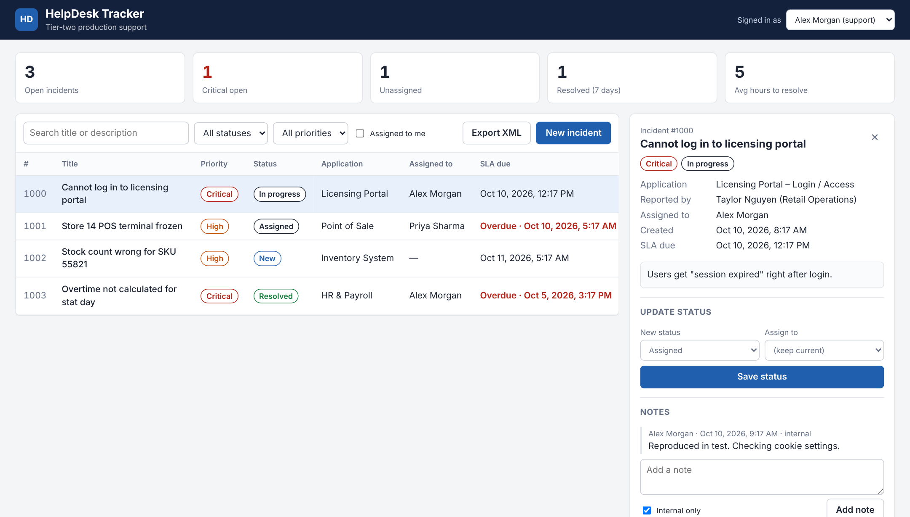

# HelpDesk Tracker

A multi-tier incident tracking application for a tier-two application support team.
Support agents log production incidents, assign them, track SLA deadlines, record the
root cause and resolution, and export incident data to XML for other systems.

**Stack:** C# · ASP.NET Core Web API (.NET 10) · SQL Server · stored procedures · ADO.NET ·
XML · JavaScript · HTML/CSS · xUnit · IIS on Windows Server



---

## Features

- **Incident dashboard**: open, critical and unassigned counts, plus average time to resolve.
- **Search and filter** by status, priority, assignee or free text.
- **Workflow rules**: New → Assigned → In progress → Resolved → Closed. Invalid moves are blocked, with a clear message.
- **SLA tracking**: due time based on priority, with overdue incidents highlighted.
- **Root cause required**: an incident cannot be resolved without a root cause and resolution, so support knowledge is captured.
- **Notes**: internal notes for the team, or notes shared with the user.
- **Audit trail**: every status change is stored in `IncidentAudit`.
- **XML export**: current filtered list downloaded as an XML file.
- **Data integrity scripts**: SQL to detect and safely correct bad data.

## Architecture

```
 Browser (HTML / CSS / JavaScript)
        │  fetch() JSON over HTTPS
        ▼
 ASP.NET Core Web API (C#)
   Controllers ─► Services (business rules) ─► Repository (ADO.NET)
        │                                        │ stored procedures only
        ▼                                        ▼
 GlobalExceptionHandler                    SQL Server database
 (consistent JSON errors + logging)        tables · view · indexes · procs
```

| Layer | Folder | What it shows |
|---|---|---|
| Presentation | `src/HelpDesk.Api/wwwroot` | Plain JavaScript, no framework; safe DOM rendering (no `innerHTML` with user data) |
| Web service | `Controllers/` | REST endpoints, model validation, proper HTTP status codes |
| Business logic | `Services/` | Workflow rules, validation, XML export |
| Domain model | `Models/` | OOP: abstract `WorkItem` base class, `Incident` inherits it, `Incident` is composed of `IncidentNote`s |
| Data access | `Data/` | Repository interface + SQL Server implementation with parameterized stored procedures |
| Database | `database/` | Normalized schema, foreign keys, CHECK constraints, indexes, a view, transactions |
| Tests | `tests/` | 27 xUnit tests using an in-memory fake repository and a controllable clock |

## How it maps to a Programmer Analyst role

| Job requirement | Where it is in this project |
|---|---|
| C#, .NET, Visual Studio | Whole `src/` solution; opens directly in Visual Studio 2022/2026 |
| SQL Server, stored procedures, normalization, indexes, keys, views | `database/01_schema.sql`, `02_stored_procedures.sql` |
| Correcting data through SQL scripting | `database/04_data_integrity_checks.sql` (detect → fix in a transaction → review → commit) |
| XML | `Services/XmlExportService.cs`, `GET /api/incidents/export.xml` |
| JavaScript, HTML | `wwwroot/` |
| Web services / service-oriented architecture | REST API that any other system can call |
| Object-oriented design (abstraction, inheritance, composition) | `Models/WorkItem.cs`, `Models/Incident.cs`, interfaces + dependency injection |
| Root cause analysis, production support | Root cause / resolution fields, audit trail, error reference ids in logs |
| Unit testing | `tests/HelpDesk.Tests` |
| Documentation, implementation planning | `docs/DEPLOYMENT.md`, `docs/KB-001-upload-limit.md` |
| Windows Server / website administration | IIS deployment guide in `docs/DEPLOYMENT.md` |

---

## Running it locally (Windows)

**You need:** Visual Studio 2022 (17.14+) or 2026 with the *ASP.NET and web development* workload,
the .NET 10 SDK, SQL Server Express or Developer edition, and SQL Server Management Studio (SSMS).

1. **Create the database.** In SSMS, connect to your local server and run:
   ```sql
   CREATE DATABASE HelpDeskTracker;
   ```
   Then open and run the scripts in `database/` in order: `01_schema.sql`, `02_stored_procedures.sql`,
   `03_seed_data.sql`. Make sure the `HelpDeskTracker` database is selected.

2. **Check the connection string** in `src/HelpDesk.Api/appsettings.json`. The default uses Windows
   authentication on `localhost`. For SQL Express use `Server=localhost\\SQLEXPRESS;...`.

3. **Run it.** Open `HelpDeskTracker.sln` in Visual Studio and press **F5**. The browser opens the
   dashboard. From the command line you can use `dotnet run --project src/HelpDesk.Api`.

4. **Run the tests.** Use *Test → Run All Tests* in Visual Studio, or `dotnet test`.

## API endpoints

| Method | URL | Purpose |
|---|---|---|
| GET | `/api/incidents?status=&priority=&assignedToId=&search=` | Search incidents |
| GET | `/api/incidents/{id}` | Incident details, notes and allowed next statuses |
| POST | `/api/incidents` | Create an incident |
| PUT | `/api/incidents/{id}/status` | Assign, change status or resolve |
| POST | `/api/incidents/{id}/notes` | Add a note |
| GET | `/api/incidents/export.xml` | Download incidents as XML |
| GET | `/api/lookups` | Categories and users for drop-downs |
| GET | `/api/dashboard` | Dashboard numbers |
| GET | `/api/health` | Health check after deployment |

Errors come back as standard JSON `ProblemDetails`. For example, trying to close a "New" incident returns:
```json
{ "status": 400, "title": "Request not allowed",
  "detail": "Cannot move an incident from New to Closed. Allowed: Assigned, InProgress, OnHold, Resolved." }
```

## Design decisions

- **Stored procedures instead of an ORM.** Many enterprise teams standardize on them. They keep SQL
  in one reviewable place, and every value is a parameter, which prevents SQL injection.
- **Business rules live in C#, data rules live in SQL.** The service layer decides what is allowed.
  The database still guarantees integrity with foreign keys and CHECK constraints, even if someone
  edits data directly in SSMS.
- **Repository interface.** It lets the business rules be unit tested without a database.
- **`TimeProvider` injection.** SLA tests use a fixed clock, so they never fail because of timing.
- **Unexpected errors show a reference id, not a stack trace.** The details go to the log, where support can find them.

## Possible next steps

- Windows authentication (Active Directory) instead of the "Signed in as" picker.
- Email notification when a Critical incident is created.
- Attachments (screenshots, log files) on incidents.
- Integration tests against a real SQL Server database.
